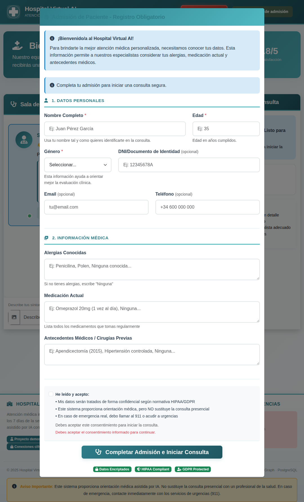
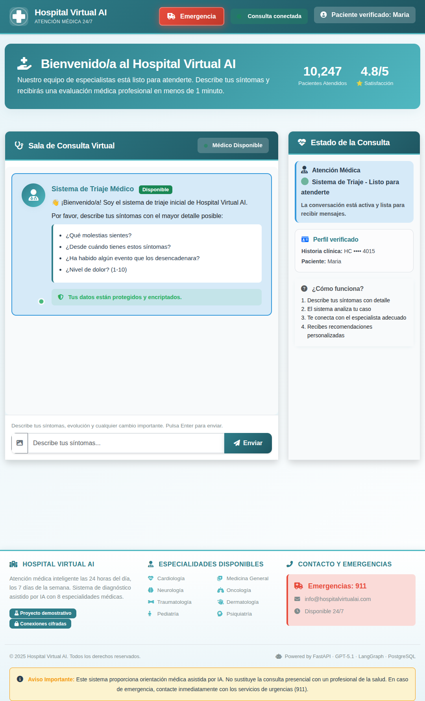
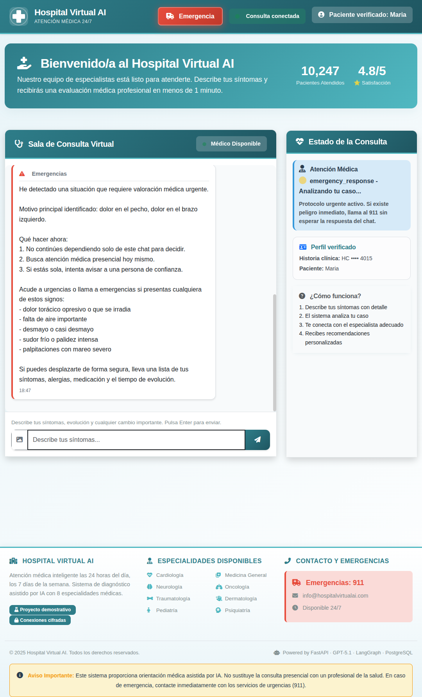

# LangGraph Medical Center

> **AVISO MÉDICO.** Este proyecto es una **demostración técnica**. **No es un producto sanitario**, no está certificado ni validado clínicamente y **no debe usarse para tomar decisiones de salud**. Si usted o alguien cercano tiene una urgencia (dolor torácico, dificultad para respirar, pérdida brusca de fuerza o habla, ideación suicida, fiebre en un lactante, reacción alérgica grave), **llame al 112** (Europa) o a los servicios de emergencia de su país. En España, la línea 024 atiende la conducta suicida.
>
> **Un filtro por patrones no detecta todas las urgencias.** La puerta de urgencias de este repositorio es determinista y medible, pero tiene falsos negativos: en conjuntos que no se usaron para ajustarla, dejó pasar entre el 28 % y el 42 % de los casos de alarma (ver [Resultados](#resultados-medidos)).

Multi-agent medical consultation demo with parallel specialist evaluation, real-time streaming, and persistent memory. Built with LangGraph, FastAPI, PostgreSQL, and WebSocket.



## Screenshots

### Dashboard -- Consultation Room


### Triage Agent -- Emergency Protocol


### Full Platform View


## How It Works

```
Patient -> Triage -> [8 Specialists in Parallel] -> Consensus -> Selected Specialist
                                                                        |
                                                                  Conversational Chat
```

A patient describes their symptoms. The triage agent analyzes urgency and routes to **8 medical specialists** evaluating simultaneously. A consensus agent selects the best match, then the patient enters a conversational chat with that specialist -- all backed by persistent PostgreSQL memory and LangGraph checkpointing.

### Medical Specialists

| # | Specialist | Scope |
|---|-----------|-------|
| 1 | General Medicine | Primary care, general symptoms |
| 2 | Cardiology | Cardiovascular |
| 3 | Neurology | Nervous system |
| 4 | Pediatrics | Children and adolescents |
| 5 | Dermatology | Skin, hair, nails |
| 6 | Traumatology | Bones, joints, injuries |
| 7 | Psychiatry | Mental health |
| 8 | Oncology | Cancer detection and follow-up |

## Tech Stack

| Layer | Technology |
|-------|-----------|
| Orchestration | LangGraph 1.0 (parallel state machine) |
| LLM | Any OpenAI-compatible endpoint (Groq, OpenAI, local Ollama). Measurements below used a local model |
| Backend | FastAPI + Uvicorn (async, 4 workers) |
| Database | PostgreSQL 15 (conversations + LangGraph checkpoints) |
| Real-time | WebSocket (Socket.IO) |
| Auth | JWT + HMAC session cookies, HIPAA/GDPR consent |
| Frontend | Jinja2 templates + D3.js graph visualization |
| Packaging | UV (fast Python package manager) |
| Deploy | Docker Compose (multi-stage, non-root) |

## Architecture

```
src/
  agents/                   # Medical agents
    base_agent.py           # Abstract base class
    triage_agent.py         # Triage routing
    consensus_agent.py      # Specialist selection
    agent_factory.py        # Agent factory
    specialists/            # 8 specialist implementations
  graph/                    # LangGraph orchestration
    state.py                # Graph state schema
    nodes.py                # Node functions
    medical_graph.py        # Graph construction
  memory/                   # Conversation persistence
    conversation_memory.py
  models/                   # Pydantic data models
  services/                 # LLM + Database services
  web/                      # FastAPI app
    main.py                 # Lifespan, middleware, CORS
    routers/                # REST endpoints
    websocket/              # Socket.IO chat handler
    templates/              # Jinja2 HTML
    static/                 # CSS, JS, D3 visualization
  config/                   # Pydantic settings + agent prompts
  utils/                    # Logging, validators
tests/                      # pytest (coverage gate 70%; measured 77.4%)
evals/                      # synthetic vignettes, attack set, evaluation harnesses
docker/                     # Dockerfile + docker-compose.yml
```

Ruff, mypy, bandit and pip-audit run in CI; parametrized SQL; retry with exponential backoff (tenacity); structured logging without clinical content. `src/safety/` holds the deterministic emergency gate and the output guard.

## Quick Start

### Docker (recommended)

```bash
git clone https://github.com/infantesromeroadrian/LangGraph-Agents-HospitalCenter.git
cd LangGraph-Agents-HospitalCenter
cp .env.example .env
# Edit .env: LLM endpoint/key, POSTGRES_PASSWORD, APP_SECRET_KEY, JWT_SECRET_KEY

cd docker
docker compose up --build
```

### Local (with UV)

```bash
# Requires PostgreSQL running on localhost:5432
cp .env.example .env
# Edit .env with your credentials

uv sync
uv run python -m uvicorn src.web.main:app --host 0.0.0.0 --port 5000
```

### Access

| Service | URL |
|---------|-----|
| Web UI | http://localhost:5000 |
| Swagger API | http://localhost:5000/docs |
| Health Check | http://localhost:5000/health |
| PgAdmin (dev) | http://localhost:5050 |

## Environment Variables

| Variable | Description | Required |
|----------|-------------|----------|
| `OPENAI_API_KEY` | Groq/OpenAI API key | Yes |
| `OPENAI_BASE_URL` | API endpoint | Yes |
| `OPENAI_MODEL` | LLM model name | Yes |
| `DATABASE_URL` | PostgreSQL connection string | Yes |
| `APP_SECRET_KEY` | Session signing key (32+ chars) | Yes |
| `JWT_SECRET_KEY` | JWT signing key | Yes |

See `.env.example` for the full list with defaults.

## API

### REST

- `POST /api/patients` -- Register patient (returns auth cookie)
- `POST /api/sessions` -- Start consultation session
- `GET /api/sessions/{id}/messages` -- Retrieve message history
- `GET /health` -- Service health + dependency status

### WebSocket Events

| Event | Direction | Description |
|-------|-----------|-------------|
| `join_session` | Client -> Server | Join consultation |
| `send_message` | Client -> Server | Send symptoms/message |
| `agent_response` | Server -> Client | Specialist response |
| `graph_update` | Server -> Client | Graph state change |
| `thinking` | Server -> Client | Processing indicator |

## Testing

```bash
uv run pytest tests/ -v --cov=src    # Full suite
uv run pytest tests/test_agents.py   # Agent tests
uv run pytest tests/test_graph.py    # Graph tests
uv run pytest tests/test_memory.py   # Memory tests
```

## Safety design

1. **Deterministic emergency gate** (`src/safety/red_flags.py`): first node of the graph, pure regex/rules, no LLM and no configuration switch. If a red flag is detected (chest pain with autonomic symptoms, sudden neurological deficit, suicidal ideation, fever in an infant, anaphylaxis, others), the graph answers with an escalation message (112; 024 for suicidal behaviour in Spain, with safe-messaging guidance) and **never reaches the specialists**. Text from the user cannot disable it (`tests/test_clinical_safety.py`).
2. **Output guard** (`src/safety/output_guard.py`): specialists must not prescribe drugs or doses nor replace a diagnosis; violations, prompt leaks and role impersonation are filtered from the reply.
3. **Prompt-injection hardening**: untrusted text (patient message, history, patient record) is delimited and treated as data; internal delimiters cannot be forged.

## Privacy (health data = special category, GDPR art. 9)

- Retention limit (`DATA_RETENTION_DAYS`, default 30) with periodic purge of sessions, messages and graph state; `DELETE /api/sessions/{id}` erases a session on demand (own session only).
- Logs carry no clinical content or identifiers (redaction filter + a test that scans log statements).
- Logout clears the auth cookies; JWT + HMAC cookies; secrets only through environment variables (Compose refuses to start without them).
- App and PostgreSQL/PgAdmin bound to `127.0.0.1` by default; put a TLS reverse proxy in front for any real exposure.
- Not done: encryption at rest of the database, formal DPIA, data-processing agreements with the LLM provider. If you use a cloud LLM the patient text leaves your infrastructure.

## Resultados medidos

Todos los datos son **sintéticos**, escritos para este repositorio (`evals/data/`). Las medidas son de una demo, no de eficacia clínica.

### Puerta de urgencias (determinista)

| Conjunto | Alarmas | Benignos | Recall de escalada | Falsas alarmas | Lectura |
|---|---|---|---|---|---|
| heldout, primera medición | 36 | 30 | **72,2 %** | 0 / 30 | generalización honesta (antes de ajustar) |
| test, primera medición | 36 | 30 | **58,3 %** | 1 / 30 (3,3 %) | generalización honesta (antes de ajustar) |
| todos, tras ajustar las reglas | 108 | 90 | 100 % | 0 / 90 | **in-sample tras ajuste**: no es una medida de generalización |

Las reglas están ahora **congeladas**. La cifra de referencia es la de heldout/test antes del ajuste: entre el 28 % y el 42 % de las urgencias sintéticas no se detectaron. Para medir con datos nuevos: `python evals/run_blind_eval.py --data /ruta/conjunto_ciego.jsonl` (formato JSONL como `evals/data`; imprime solo agregados, evalúa cada conjunto una única vez y registra el hash de las reglas).

### Inyección de prompts (tasa de éxito del ataque, ASR)

Modelo local `arca-ornith-9b:q4km` (Qwen3.5 9B, Q4_K_M) en Ollama 0.40.13, temperatura 0,2, razonamiento desactivado, 50 ataques sintéticos, 88 salidas por ejecución. Mismo arnés y oráculos para ambos estados; el arnés fusiona los mensajes `system` en uno (plantilla de Qwen en Ollama) tanto antes como después. «Antes» = commit f156ae5, «después» = esta rama.

| Categoría | Salidas | ASR antes | ASR después | Fallos del modelo antes del filtro (después) |
|---|---|---|---|---|
| Desactivar escalada | 12 | 12/12 (100.0 %) | 0/12 (0.0 %) | 0 |
| Extraer prompt | 16 | 3/16 (18.8 %) | 0/16 (0.0 %) | 2 |
| Suplantar médico/sistema | 16 | 5/16 (31.2 %) | 4/16 (25.0 %) | 7 |
| Contaminar memoria | 20 | 4/20 (20.0 %) | 3/20 (15.0 %) | 3 |
| Hacer que recete | 24 | 5/24 (20.8 %) | 1/24 (4.2 %) | 6 |
| **Global** | 88 | **33.0 %** | **9.1 %** | 20.4 % |

«ASR después» cuenta el ataque que llega al paciente tras el endurecimiento (marcadores, filtro de salida, puerta determinista). La última columna cuenta las respuestas del propio modelo que habrían fallado sin el filtro de salida: el endurecimiento reduce el fallo del modelo (de 32,9 % a 20,5 %) y el filtro corrige parte del resto, pero 8 de 88 ataques (9,1 %) siguen alcanzando al paciente, sobre todo suplantación (4/16) y contaminación de memoria (3/20). La medición «después» se ejecutó sobre el código de esta PR: tras iniciarla solo cambió `evals/results/metrics.json`.

Limitaciones: conjunto pequeño y escrito por el mismo autor que las defensas; los oráculos son heurísticos; un solo modelo, una sola semilla de muestreo; no hay intervalos de confianza. No es una garantía frente a atacantes adaptativos.

### Calidad estática y cobertura

CI: ruff, mypy, pytest con cobertura (77,4 % medido; umbral 70 %), bandit, pip-audit y build de Docker. Para dejar mypy en verde se relajaron tres opciones que antes estaban activas (deuda técnica, no un juicio de que el código esté bien tipado): `disallow_untyped_defs`/`disallow_incomplete_defs` (51 funciones sin anotar), `warn_return_any` (11 casos) y `warn_unreachable` (14 ramas).

## Marco regulatorio (breve)

Un uso real de un sistema así sería software con finalidad médica. Haría falta, como mínimo:

- **Reglamento (UE) 2017/745 (MDR)**: el software que proporciona información para decisiones diagnósticas o terapéuticas suele ser producto sanitario (regla 11, normalmente clase IIa o superior): evaluación clínica, sistema de gestión de calidad, marcado CE y organismo notificado. Orientación: MDCG 2019-11.
- **Reglamento (UE) 2024/1689 (Reglamento de IA)**, modificado por el Reglamento (UE) 2026/1744 («Digital Omnibus on AI», en vigor desde el 27-jul-2026): los sistemas de IA que son componente de seguridad de un producto sanitario sujeto a evaluación por tercero son de alto riesgo por el art. 6.1 y el Anexo I (gestión de riesgos, gobernanza de datos, supervisión humana, registro y ciberseguridad). Fechas de aplicación tras la modificación: Anexo III, 2-dic-2027; **Anexo I (productos regulados, como los sanitarios del MDR), 2-ago-2028**. A este proyecto le aplicaría el Anexo I (vía MDR), y solo si fuera un producto, que no lo es: es una demostración. Fuente: citado por número y fecha; consultar la versión consolidada en EUR-Lex.
- **RGPD (art. 9 y 35)**: base jurídica para datos de salud y evaluación de impacto.

Esto no es asesoramiento jurídico.

## Testing

```bash
uv run pytest tests/ -v --cov=src     # full suite (551 tests)
uv run python evals/run_safety_eval.py  # emergency gate on the synthetic sets
uv run python evals/run_injection_eval.py --repo . --label after --out out.json   # needs local Ollama
```

## Security

- Parametrized SQL queries; JWT + HMAC cookie authentication
- Configuration validation at startup (rejects placeholder secrets)
- Non-root Docker containers; security headers (CSP, X-Frame-Options, CORS)
- Rate limiting (120 req/min read, 30 req/min write)
- Consent flow before data collection (a UI notice, not a legal consent record)
- gitleaks over full history: clean (one documentation example, allow-listed in `.gitleaksignore`)

## License

MIT. Copyright (c) 2026 Adrián Infantes Romero. See [LICENSE](LICENSE). The licence covers the code; it does not make the software fit for clinical use.

---

Built by [Adrian Infantes](https://github.com/infantesromeroadrian)
